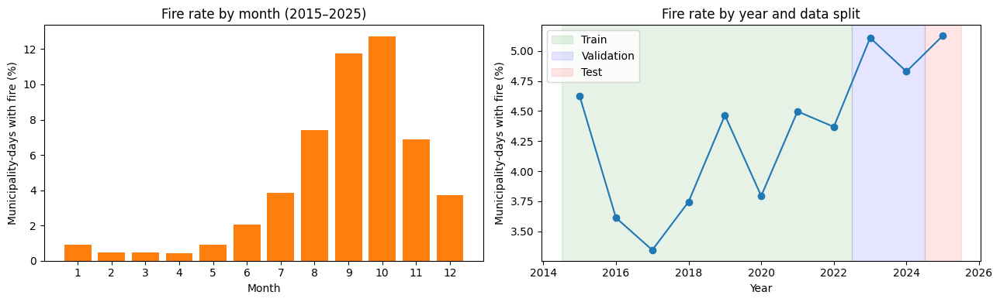
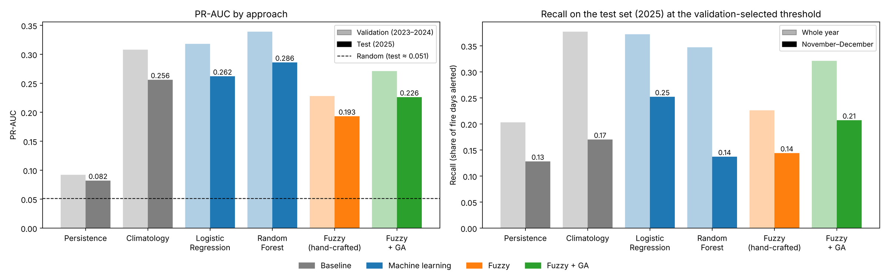

# Daily Wildfire Prediction in Piauí, Brazil: What Do Weather Variables Add Beyond Season, Location and Recent Fire Activity?

**Monnik Luianne Oliveira Nascimento Veloso Barbosa**

Departamento de Computação – Universidade Federal do Piauí (UFPI)  
Teresina – PI – Brasil

monnik.barbosa@ufpi.edu.br

***Abstract.** We ask whether weather adds predictive power beyond season, location and recent fire activity for one-day-ahead wildfire detection in the 224 municipalities of Piauí, Brazil. Combining 118,402 INPE detections (2015–2025) with NASA POWER weather (893,312 municipality-days, 4.3% positive), a Random Forest reached a test PR-AUC of 0.286 and beat climatology and logistic regression in all years of a walk-forward evaluation. An ablation study showed that the gain comes mainly from recent fire activity, while weather adds only a small increment. A Mamdani fuzzy index reached 79% of the Random Forest's PR-AUC after genetic-algorithm tuning and was more robust in an atypical late season. New outbreaks remained unpredictable.*

## 1. Introduction

Vegetation fires are a recurring problem in Piauí, which concentrates the largest share of fire detections among the states of the Caatinga [Amorim and Santos 2026]. Fire activity peaks in the dry season and is largely associated with land clearing and pasture renewal, favored by dry weather [Nascimento et al. 2017]. Since prevention resources are limited, a daily risk indicator per municipality could help decide where to act. The task is intrinsically hard: fire is rare (about 4% of municipality-days), ignition is mostly human, satellites miss small or cloud-covered fires, so the absence of a detection does not prove the absence of fire [Giglio et al. 2016], and gridded weather data describe regional rather than local conditions.

This work predicts, one day in advance, whether at least one active fire will be detected in each of the 224 municipalities of Piauí, using only public data. The research question is: **do meteorological variables add predictive power beyond location, season and recent fire activity?** A secondary question is whether an interpretable fuzzy rule base, hand-crafted or tuned by a genetic algorithm (GA), can approach a data-driven model. The contributions are a reproducible municipality-day dataset evaluated chronologically under natural class imbalance, an ablation study stable across seeds and years, an error analysis of new outbreaks and an atypical season, and a comparison between machine learning and fuzzy inference.

## 2. Related Work

The association between climate and fire in Piauí is documented at aggregated scales: in Parnaguá, drier years had more detections, but 2015 was atypical, with more rain and more fires concentrated in October–December [Nascimento et al. 2017]. Such studies do not measure what daily weather adds to a predictor that already knows the season and the recent fire activity. In Brazil, [Amorim and Santos 2026] predicted daily fire occurrence in Piauí with LightGBM and INMET stations, reporting 82% accuracy, F1 of 0.83 and ROC-AUC of 0.90. These figures are not comparable with ours: negatives were sampled at least 40 km away from any fire, making classes spatially separable; the split was random, so days of the same season appear in training and test; and accuracy and ROC-AUC are optimistic under imbalance [Saito and Rehmsmeier 2015]. We keep every municipality-day, split chronologically and use PR-AUC. For knowledge-based models, [Duarte 2022] used fuzzy inference to model fire susceptibility, and GA tuning of fuzzy systems is well established [Cordón et al. 2004].

## 3. Methodology

### 3.1. Data, Target and Features

We combined (i) 118,402 detections of INPE's reference satellite (`AQUA_M-T`) in Piauí, 2015–2025 [INPE 2026], a single satellite that keeps the series consistent across years; (ii) daily NASA POWER data [NASA 2026] at each municipal seat (maximum and mean temperature, relative humidity, precipitation and wind speed); and (iii) IBGE-based coordinates of the 224 municipalities. Each row is a (municipality, day) pair, and the target is 1 if at least one fire was detected (38,879 of 900,032 rows, 4.32%); a target of 0 means *no detection*, not certainty of absence. To predict day D, all 16 features use information up to D−1, preventing leakage: **weather** (previous-day values; rainfall over 7 and 30 days; 7-day means of humidity and maximum temperature; consecutive days with less than 1 mm of rain), **fire history** (fire on D−1, `fire_lag1`; fire days in the previous week, `fire_7d`) and **context** (month as sine and cosine; latitude and longitude). After dropping the first 30 days of 2015, 893,312 rows remain.

### 3.2. Protocol and Models

The data were split chronologically by whole years: training 2015–2022 (4.09% positives), validation 2023–2024 (4.97%) and test 2025 (5.13%), about 72/18/9%. The primary metric is PR-AUC, for which a random classifier scores the positive rate [Saito and Rehmsmeier 2015]; precision, recall and F1 use the threshold that maximizes F1 on validation, and the test set was used once. Baselines were persistence (fire on D if fire on D−1), climatology (training fire rate per municipality and month) and logistic regression. The main model is a Random Forest [Breiman 2001] in scikit-learn with 200 trees, at least 50 samples per leaf, √p features per split, 30% of the rows per tree and balanced class weights. We also computed permutation importance, an ablation study by feature group, stability over five seeds, an error analysis and a walk-forward evaluation (for each year from 2021 to 2025, training on all previous years).

### 3.3. Fuzzy Inference and Genetic Algorithm

A Mamdani system [Mamdani and Assilian 1975] uses trapezoidal sets for recent activity (`fire_7d`: none, some, intense), 30-day rainfall (dry, moderate, wet; a dryness proxy independent of the calendar), previous-day humidity (low, medium, high) and maximum temperature (hot). Limits were checked against training quantiles (median humidity of 39% on fire days vs 56% otherwise). Nine rules, such as *IF activity is intense AND rainfall is dry THEN risk is very high*, are combined with minimum, maximum and centroid defuzzification. A GA then tuned nine genes (set limits and a shift of the *high* output set) with fixed rules; fitness was the PR-AUC on 100,000 training rows, with tournament selection, arithmetic crossover, Gaussian mutation, elitism, population 30 and 25 generations. The GA was added after the hand-crafted index had been tested; it uses only training and validation data, and both versions are reported.

## 4. Results and Discussion

### 4.1. Exploratory Analysis and Overall Comparison

Fire is strongly seasonal (Figure 1): below 1% of municipality-days from January to May and 12–13% in September–October. Fire days are drier (median humidity ≈40% vs ≈55%) and hotter, but distributions overlap and partly reflect seasonality.

**Figure 1. Fire rate by month (left) and by year, with the data split (right).**

The Random Forest is the best model on validation and test (Table 1, Figure 2). All models, including climatology, which cannot overfit, lose 16–18% of PR-AUC on the test set, pointing to a harder test year rather than overfitting. In 2025, the Random Forest raised 4,495 alerts: 1,454 correct (35% of the 4,191 fire days) and about two false alarms per correct alert, a precision about six times that of random alerts.

**Table 1. PR-AUC on validation and test; test precision, recall and F1.**

| Model | PR-AUC (val.) | PR-AUC (test) | Precision | Recall | F1 |
| :---- | :---: | :---: | :---: | :---: | :---: |
| Persistence | 0.092 | 0.082 | 0.203 | 0.203 | 0.203 |
| Climatology | 0.308 | 0.256 | 0.277 | 0.377 | 0.319 |
| Logistic regression | 0.318 | 0.262 | 0.291 | 0.372 | 0.326 |
| Random Forest | 0.339 | 0.286 | 0.323 | 0.347 | 0.335 |
| Fuzzy (hand-crafted) | 0.228 | 0.193 | 0.334 | 0.226 | 0.270 |
| Fuzzy + GA | 0.271 | 0.226 | 0.293 | 0.321 | 0.306 |

**Figure 2. PR-AUC on validation (light) and test (dark), and test recall for the whole year (light) and for November–December (dark).**

### 4.2. Ablation Study: What Weather Adds

Permutation importance shows that `fire_7d` dominates (shuffling it reduces PR-AUC by about 0.16), whereas `fire_lag1` is the least important, consistent with weak persistence. Table 2 isolates each group. Context alone matches climatology; weather alone carries signal but much less. Surprisingly, adding weather to context *reduces* PR-AUC (−0.026), fire history increases it (+0.024), and weather adds only +0.006 once fire history is known. The seed standard deviation is at most 0.0006, and the signs hold on the test set (−0.024, +0.017, +0.012). Plausible causes of the loss are redundancy with seasonality, the ≈50 km weather resolution and the √p split rule, under which about one third of the splits cannot use any context feature. **Thus, weather adds little beyond location, season and recent fire activity.**

**Table 2. Ablation (Random Forest): validation PR-AUC (mean ± s.d., 5 seeds) and test PR-AUC.**

| Feature groups | Features | PR-AUC (val.) | PR-AUC (test) |
| :---- | :---: | :---: | :---: |
| Context only | 4 | 0.3096 ± 0.0001 | 0.257 |
| Weather only | 10 | 0.197 (one seed) | – |
| Context + weather | 14 | 0.2839 ± 0.0006 | 0.233 |
| Context + fire history | 6 | 0.3335 ± 0.0002 | 0.274 |
| All features | 16 | 0.3391 ± 0.0004 | 0.286 |

### 4.3. Robustness and Error Analysis

In the walk-forward evaluation, the Random Forest beat climatology in all five years (+0.026 to +0.062) and logistic regression in all five (+0.003 to +0.028), with mean PR-AUC of 0.342 ± 0.039; the weather gain given fire history was positive in four years but always small. The error analysis reveals the main limitation: new outbreaks (no fire in the previous week) are 32% of the 2025 fire days, but their recall is 0.4%, against 50.8% for ongoing activity, so the model mainly detects continuing fire. The 2025 season also extended late (November fire rate of 11.4% vs ≈6.9% historically), and November–December, with 27% of the fire days, had a recall of only 0.137. Finally, a single statewide threshold favored the Cerrado (recall 54%) over the Caatinga (24%), which holds 65% of the fire days.

### 4.4. Fuzzy Inference and Genetic Algorithm

With nine rules and no training, the fuzzy index reached a test PR-AUC of 0.193 (two thirds of the Random Forest) with similar precision. The GA raised it to 0.226 (79%), with nearly identical gains on training, validation and test (+17–19%), so it did not overfit. It widened *low* humidity (up to 64%) and *dry* rainfall (up to 55 mm) and lowered the *high* output set, reinforcing the reliance on recent activity; several genes stopped at bounds set to keep the sets meaningful, showing a trade-off between accuracy and interpretability. Neither fuzzy version alerted new outbreaks, but the GA-tuned index kept a late-season recall of 0.207 against 0.137 for the Random Forest at similar overall recall, and logistic regression reached 0.252: smoother models were more robust to the atypical season.

### 4.5. Why Performance Is Modest

The modest values reflect the problem rather than the method: fire is rare, ignition is mostly human and its drivers (land use, agricultural calendar) are absent, weather data are coarse, and labels are positive-unlabeled, since non-detections are not reliable negatives [Elkan and Noto 2008]. Higher scores in the literature come from easier settings (Section 2); ours reflect daily operational use at the municipal scale.

## 5. Conclusion

Using public data, a chronological protocol and PR-AUC, the Random Forest was the best one-day-ahead fire predictor for the municipalities of Piauí and was robust across years. The research question was answered: weather adds little beyond location, season and recent fire activity. The fuzzy index offered an interpretable alternative, reaching 79% of the Random Forest after GA tuning and coping better with an atypical late season. The main limitations are the failure on new outbreaks, the dependence on the usual seasonal pattern, the biome bias of a single threshold and label noise. Future work includes a more sensitive fire product (VIIRS) to measure label noise, positive-unlabeled learning, region-specific thresholds, land-use variables and a dedicated model for new outbreaks.

## 6. Data and Code Availability

All resources are public and require no login, API key or access request. The repository contains the notebook, with all outputs saved, the INPE detections (`data/raw/`), the NASA POWER weather and the **integrated dataset** built in this work (one row per municipality-day with daily weather and the fire label; 900,032 rows), both in `data/processed/`. To reproduce the results, open the notebook in Google Colab and select *Runtime → Run all*; all data are loaded directly from the repository. The full run takes about 1h20; setting `RUN_STABILITY` and `RUN_WALK_FORWARD` to False in Section 3 of the notebook gives a quick run of about 20 minutes.

- Repository: [https://github.com/MonnikLuianne/wildfire-risk-piaui](https://github.com/MonnikLuianne/wildfire-risk-piaui)
- Notebook (GitHub): [https://github.com/MonnikLuianne/wildfire-risk-piaui/blob/main/wildfire_risk_piaui.ipynb](https://github.com/MonnikLuianne/wildfire-risk-piaui/blob/main/wildfire_risk_piaui.ipynb)
- Notebook (Colab): [https://colab.research.google.com/github/MonnikLuianne/wildfire-risk-piaui/blob/main/wildfire_risk_piaui.ipynb](https://colab.research.google.com/github/MonnikLuianne/wildfire-risk-piaui/blob/main/wildfire_risk_piaui.ipynb)
- Integrated dataset: [https://github.com/MonnikLuianne/wildfire-risk-piaui/blob/main/data/processed/dataset_integrated_PI_2015_2025.csv.gz](https://github.com/MonnikLuianne/wildfire-risk-piaui/blob/main/data/processed/dataset_integrated_PI_2015_2025.csv.gz)
- Slides: [https://canva.link/tepnv3z2bvue33f](https://canva.link/tepnv3z2bvue33f)

## 7. Use of Large Language Models

Claude (Anthropic) was used to brainstorm the topic, suggest data sources, discuss the experimental design, debug errors and explain concepts. The author executed all code, checked every output, reviewed the text, made the methodological decisions and is responsible for all content.

## References

Amorim, D. B. S. and Santos, J. D. (2026). Aplicação de machine learning em dados climáticos para a predição de incêndios na Caatinga piauiense. Undergraduate thesis, Instituto Federal do Piauí.

Breiman, L. (2001). Random forests. *Machine Learning*, 45(1):5–32.

Cordón, O., Gomide, F., Herrera, F., Hoffmann, F. and Magdalena, L. (2004). Ten years of genetic fuzzy systems: current framework and new trends. *Fuzzy Sets and Systems*, 141(1):5–31.

Duarte, M. L. (2022). Previsão da suscetibilidade a incêndios e queimadas utilizando um modelo baseado em inteligência artificial e sistema de inferência fuzzy. UNESP, Sorocaba.

Elkan, C. and Noto, K. (2008). Learning classifiers from only positive and unlabeled data. In *Proc. 14th ACM SIGKDD*, pages 213–220.

Giglio, L., Schroeder, W. and Justice, C. O. (2016). The collection 6 MODIS active fire detection algorithm and fire products. *Remote Sensing of Environment*, 178:31–41.

INPE (2026). Programa Queimadas – BDQueimadas. https://terrabrasilis.dpi.inpe.br/queimadas/bdqueimadas/.

Mamdani, E. H. and Assilian, S. (1975). An experiment in linguistic synthesis with a fuzzy logic controller. *International Journal of Man-Machine Studies*, 7(1):1–13.

NASA (2026). POWER Project – Prediction Of Worldwide Energy Resources. https://power.larc.nasa.gov.

Nascimento, O. S., Souza, Í. R. M., Nascimento, W. P. S. and Nascimento, J. S. (2017). Análise espaço-temporal dos focos de calor no município de Parnaguá, Piauí, entre 2008 a 2015. *Revista Brasileira de Gestão Ambiental*, 11(1):193–199.

Saito, T. and Rehmsmeier, M. (2015). The precision-recall plot is more informative than the ROC plot when evaluating binary classifiers on imbalanced datasets. *PLoS ONE*, 10(3):e0118432.
